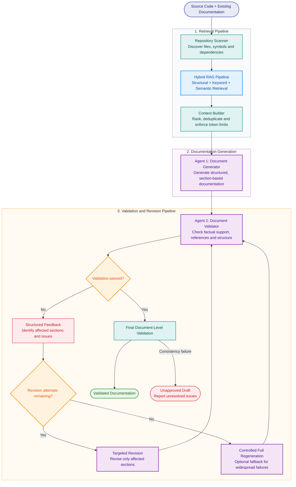

# Agent Architecture

## Version 1

The initial AI agent architecture follows a sequential pipeline with a bounded feedback loop for correcting documentation validation failures.

**Pipeline:** Repository Scanning → Hybrid Retrieval-Augmented Generation (RAG) → Context Building → Document Generation → Document Validation → Targeted Revision (if required) → Final Validation → Documentation Output.

### Pipeline Components

- **Repository Scanner:** Identifies source code files, existing documentation, relevant symbols, imports, and code relationships required for documentation generation.

- **Hybrid RAG Pipeline:** Combines structural retrieval, keyword-based search, and semantic search to identify source code and existing documentation relevant to the documentation task. Retrieval results are ranked and deduplicated downstream to reduce redundant context.

- **Context Builder:** Organizes the retrieved information, ranks it by relevance, removes duplicates, and assembles supporting evidence within the model's context limits. It prepares the structured context required by the Document Generator.

- **Agent 1 - Document Generator:** Uses the prepared context to generate structured documentation according to the selected documentation style and requirements. Generated documents are represented as identifiable sections so that individual sections can be revised independently.

- **Agent 2 - Document Validator:** Evaluates the generated documentation for factual support, consistency with the source code, valid references, and compliance with the required documentation structure. Where possible, deterministic checks are used for verifiable properties, while semantic consistency checks may use an LLM.

- **Validation Feedback and Targeted Revision:** If validation fails, the validator returns structured feedback identifying the affected sections, validation issues, and supporting evidence where available. The Document Generator uses this feedback to revise only the affected sections, preserving unaffected content wherever possible. The revised sections are then validated again.

- **Final Validation and Documentation Output:** Once the targeted revisions pass their section-level checks, the complete document undergoes a final consistency check. Documentation that passes validation is prepared for output. If validation continues to fail, the system retains the result as an unapproved draft and reports unresolved issues instead of silently marking it as validated.

### Retry and Failure Handling

The initial implementation will permit a maximum of two revision attempts after the initial generation. The orchestrator will enforce this limit to prevent unbounded generation cycles and excessive LLM usage. If failures are widespread or targeted revision is unsuitable, full document regeneration may be used as a controlled fallback.

The initial implementation will prioritize modularity, traceability, efficient context utilization, and bounded LLM usage. More advanced retrieval techniques, validation mechanisms, and recovery strategies can be introduced as the system evolves.

## Architecture Diagram

